# Лабораторная работа 5 — Zero-trust сеть

Окружение: macOS + colima (4 CPU / 8 GiB), kind-кластер из 3 нод (control-plane + 2 воркера).

## Part 0 — Выбор CNI

Взял Cilium. Дефолтный для kind kindnet вообще не умеет NetworkPolicy — объект в API
создаётся, но трафик никто не режет, так что CNI в любом случае надо менять.

Из пары Cilium / Calico выбрал Cilium в основном из-за Hubble: он записывает вердикт по
каждому потоку (FORWARDED / DROPPED) и причину дропа. В части про диагностику поломки это
сильно пригодится — можно будет не гадать, а посмотреть, какое соединение дропается и какой
политикой. Ну и сами политики у Cilium исполняются в eBPF, а не в простынях iptables.
Calico политики тоже честно исполняет, но готовой карты потоков в open-source версии у него
нет, пришлось бы собирать картину по логам.

## Part 1 — Сеть пода

Кластер поднят kind'ом с `disableDefaultCNI: true`, поверх поставлен Cilium
(`cilium install`, v1.20). Пока CNI не стоял, ноды висели в NotReady — kubelet не нашёл
конфиг плагина в `/etc/cni/net.d/`, и обычные поды (включая CoreDNS) не шедулились.
При этом apiserver и etcd спокойно работали: они на hostNetwork и от CNI не зависят.

Приложение — чарт shop из прошлой лабы (`helm install shop lab/charts/shop -n shop`).
Образы собраны локально и загружены через `kind load docker-image`: у каждой kind-ноды
свой containerd, docker-демон colima для них не источник образов.

Одну вещь в чарте пришлось поправить: в topologySpreadConstraints добавил
`nodeTaintsPolicy: Honor`. Без него третья реплика api не шедулилась — затейнченный
control-plane считается отдельным доменом с 0 подов, и skew выходил 2 при maxSkew 1.
В лабе 4 затейнченных нод не было, поэтому там это не вылезало.

Теперь сама сеть, на примере пода `shop-api-...-rj9j9` (10.244.2.12, нода shop-worker2).
В под через exec не зайти (образ distroless, шелла нет), поэтому `kubectl debug` с
эфемерным контейнером.

Внутри пода один интерфейс `eth0@if19` с адресом `10.244.2.12/32`. IP совпадает с тем,
что видит кластер, то есть NAT между подами нет. Маска /32 — Cilium не сажает поды на
общий L2-сегмент, каждый под маршрутизируется отдельно.

На ноде ищем второй конец veth-пары: `ip -o link | grep '^19:'` →
`lxc6cacd26b6abd@if18` (18 в поде ↔ 19 на ноде), `link-netns` указывает на netns пода.

Бриджа на ноде нет — `ip link show type bridge` пустой (kindnet построил бы мост).
Вместо него eBPF: `bpftool net show dev lxc6cacd26b6abd` показывает программу
`cil_from_container` на tcx/ingress. Через неё проходит каждый пакет из пода, и она же
потом будет резать трафик по NetworkPolicy.

Пинг между подами на разных нодах проходит напрямую по pod IP.

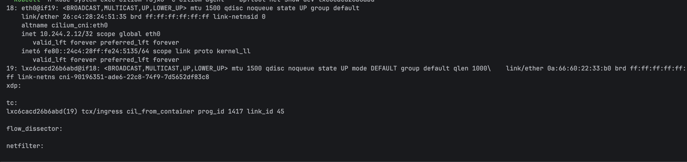

## Part 2 — Непрерывность под хаосом

api временно выставил наружу через NodePort (в values `api.service.type: NodePort`,
`nodePort: 30080`; в kind этот порт проброшен с хоста через `extraPortMappings`).
Коротко про типы сервисов:

- ClusterIP — виртуальный IP, виден только внутри кластера (так живёт postgres);
- NodePort — тот же ClusterIP плюс порт на каждой ноде, с любой ноды трафик дорулит
  до пода, даже если под на другой ноде;
- LoadBalancer — NodePort плюс внешний балансировщик от облака; в kind его некому
  выдать, сервис вечно висел бы в Pending;
- headless (`clusterIP: None`) — без виртуального IP, DNS сразу отдаёт IP подов
  (так живёт worker).

Хаос: скрипт `chaos/kill-pods.sh` убивает случайный под api/worker каждые 5 секунд.
Нагрузка: k6 с хоста в NodePort, 30 заказов/с, 3 минуты. За прогон набежало 35 убийств,
состав подов между снимками (`chaos/pods-churn-3.log`) менялся почти полностью.

С первого раза зелёный график не получился, было два неудачных захода:

1. 0.61% ошибок, и у части запросов латентность ровно 1/2/4 секунды — это SYN-ретраи.
   Приложение не обрабатывало SIGTERM и умирало мгновенно, обрывая запросы в полёте,
   а правила на нодах обновляются асинхронно, так что новые SYN ещё прилетали в мёртвый
   IP. Починил с двух сторон: graceful shutdown в приложении (`http.Server.Shutdown`
   по SIGTERM) и `preStop` sleep на 5 секунд в деплойменте — под, которого уже нет в
   EndpointSlice, ещё отвечает, пока ноды перепрограммируют правила. preStop пришлось
   делать нативным sleep-хендлером: в distroless нет шелла для `exec sleep`.
2. 4.32% ошибок, причём все таймауты в одном 40-секундном окне. В логах свежего пода
   api — connection refused к postgres, а у `shop-postgres-1` рестарт с exit code 137
   ровно в это время. Постгресу остался CPU-лимит 100m из лабы 4: 30 insert/с плюс шторм
   переподключений от пересоздаваемых подов api затроттлили его настолько, что перестала
   отвечать liveness-проба, и kubelet его убил. Поднял лимит до 500m.

Третий прогон: 5401 запрос из 5401 успешен, 0 ошибок, p95 = 4.67 мс — при 35 убийствах
подов за 3 минуты. Постгрес прошёл прогон без рестартов.

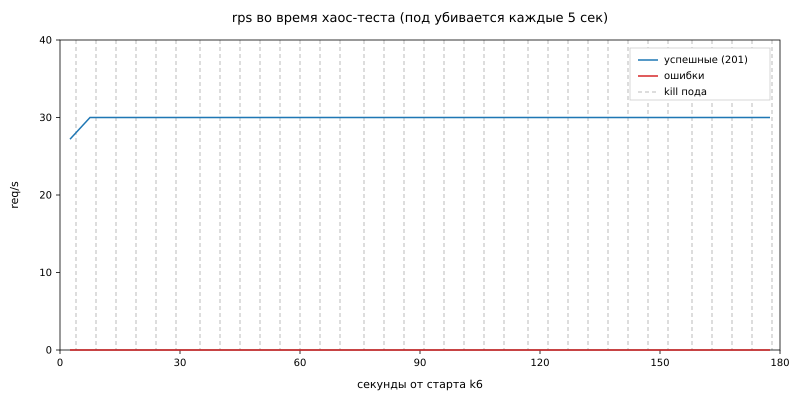

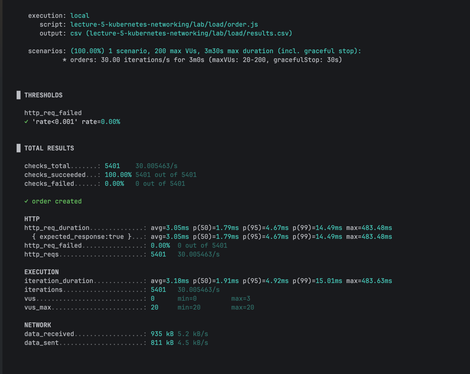

Почему это работает:

- у сервиса стабильный виртуальный адрес (ClusterIP / NodePort), клиент всегда ходит
  в одну точку;
- EndpointSlice-контроллер держит актуальный список IP готовых подов: под умер — IP
  убрали, новый прошёл readiness — добавили;
- kube-proxy на каждой ноде следит за EndpointSlice и перенастраивает правила
  (у нас iptables DNAT): пакет на NodePort/ClusterIP → один из живых pod IP;
- DNS резолвит `shop-api.shop.svc` в ClusterIP, а не в IP подов, поэтому кэширование
  DNS-ответов не мешает — текучка подов на уровне DNS вообще не видна.

Режим kube-proxy у нас iptables (видно в конфигмапе kube-proxy и в логах — `Using
iptables Proxier`). Разница с IPVS играет на масштабе: iptables — линейный список
правил, который на тысячах сервисов долго перестраивается и просматривается, IPVS —
хэш-таблицы плюс нормальные алгоритмы балансировки. На нашем десятке сервисов разницы
никакой. Ещё можно было выкинуть kube-proxy целиком и отдать сервисный трафик eBPF
(kube-proxy replacement в Cilium), но оставил kube-proxy, чтобы посмотреть классический
путь.

## Part 3 — Целевая матрица доступа

Прежде чем включать default deny, выписал всех, кто с кем легитимно разговаривает.
Логика простая: по каждому компоненту в namespace shop два вопроса — кто ходит к нему
и куда ходит он сам. Плюс системные потоки, которые проще всего забыть: DNS, оператор
постгреса и мониторинг.

В кластере сейчас: api ×3 и worker ×2 в shop, postgres под управлением CloudNativePG
(оператор живёт в cnpg-system), kube-prometheus-stack в monitoring, CoreDNS в
kube-system. Ingress-контроллера нет, клиент заходит с хоста через NodePort.

| Откуда | Куда | Порт | Доступ |
|---|---|---:|:---:|
| клиент снаружи (NodePort 30080) | api | 8080/TCP | разрешено |
| api | postgres (shop-postgres-rw) | 5432/TCP | разрешено |
| worker | postgres (shop-postgres-rw) | 5432/TCP | разрешено |
| CNPG-оператор (cnpg-system) | под postgres | 8000/TCP | разрешено |
| под postgres | kube-apiserver | 6443/TCP | разрешено |
| поды postgres между собой (репликация) | под postgres | 5432, 8000/TCP | разрешено |
| Prometheus (monitoring) | api, worker | 8080/TCP | разрешено |
| api, worker, postgres | CoreDNS (kube-system) | 53/UDP+TCP | разрешено |
| посторонний под | api, worker, postgres | любой | запрещено |
| api, worker | что угодно кроме postgres и DNS | любой | запрещено |
| worker | api | любой | запрещено |

Неочевидные строки, из-за которых всё обычно и ломается:

- **DNS.** Default deny на egress режет и резолв имён. Без разрешения на kube-dns:53
  api не сможет превратить `shop-postgres-rw` в IP — упадёт всё, хотя «к постгресу
  доступ есть».
- **CNPG-оператор → postgres:8000.** Оператор ходит в под БД на служебный порт
  (статус инстанса, управление). Закрыть — кластер БД перестанет управляться.
- **postgres → apiserver:6443.** Инстанс-менеджер CNPG внутри пода БД читает
  конфигурацию из Kubernetes API, в том числе на этапе initdb. Без этого правила
  под БД просто не инициализируется и зависнет.
- **Prometheus → 8080.** Скрейп /metrics прилетает из чужого namespace monitoring.
  Забыть — тихо умрут метрики и алерты, заметишь не сразу.
- **api и worker друг с другом не общаются** — оба ходят только в БД, поэтому
  горизонтальный трафик между ними тоже запрещён.

Отдельно про первую строку: трафик с хоста приходит через NodePort после DNAT, с точки
зрения политики это источник за пределами под-сети, а не какой-то конкретный под. Это
придётся учесть при написании ingress-правила для api.

## Part 4 — Zero trust: NetworkPolicy в чарте

Политики добавлены в чарт шаблоном `templates/networkpolicies.yaml`, всё управляется
через values:

```yaml
networkPolicy:
  enabled: true
  clientCIDR: 172.23.0.0/16
  monitoringNamespace: monitoring
  cnpgNamespace: cnpg-system
  apiServerPorts:
    - 443
    - 6443
```

Получилось 4 политики — перевод матрицы из Part 3 один в один:

- `shop-default-deny` — пустой podSelector, policyTypes Ingress+Egress. Ловит все поды
  namespace и запрещает всё; дальше остальные политики только добавляют разрешения
  (NetworkPolicy аддитивны, запретить что-то поверх нельзя, можно только разрешить).
- `shop-api` — ingress на 8080 из `clientCIDR` (сеть нод kind — трафик с хоста приходит
  через NodePort после DNAT) и от Prometheus из namespace monitoring; egress только в
  поды постгреса на 5432 и в kube-dns на 53.
- `shop-worker` — то же самое, но без клиентского ingress: снаружи к worker никто не
  ходит, только Prometheus за метриками.
- `shop-postgres` — ingress на 5432 от api и worker, на 8000 от CNPG-оператора из
  cnpg-system, плюс 5432/8000 от других подов того же кластера БД (на будущее, под
  репликацию); egress к apiserver (443/6443), к соседям по кластеру БД и в DNS.

Поды выбираются лейблами, которые чарт и так ставит (`app.kubernetes.io/component`),
постгрес — лейблом CNPG `cnpg.io/cluster: shop-postgres`. Namespace'ы матчатся по
стандартному `kubernetes.io/metadata.name`, его kubernetes вешает сам.

После `helm upgrade` сразу видно, что базовое ничего не сломалось: поды Ready (пробы
kubelet'а политиками не режутся — Cilium всегда пропускает трафик с локальной ноды),
worker в логах продолжает обрабатывать заказы, то есть его путь до БД и DNS живы.

А вот первая же проверка снаружи поймала проблему: curl на NodePort завис. Висит, а не
Connection refused — значит, пакеты молча дропаются, это почерк default deny. Смотрим
Hubble на ноде с подом api:

```
10.244.1.233:36376 (world) <> shop/shop-api-...:8080 policy-verdict:none INGRESS DENIED (TCP Flags: SYN)
10.244.1.233:36376 (world) <> shop/shop-api-...:8080 Policy denied DROPPED (TCP Flags: SYN)
```

Тут видно сразу две вещи. Источник — 10.244.1.233: это не IP ноды из сети 172.23.0.0/16,
а адрес ноды внутри pod-сети (cilium_host): kube-proxy после DNAT замаскарадил клиента
в него. Мой первоначальный `clientCIDR: 172.23.0.0/16` в него не попадал. И вторая вещь —
пометка `(world)`: Cilium принимает решение не по IP, а по identity источника, и этот
адрес он отнёс к «внешнему миру». `policy-verdict:none` — ни одно правило не разрешило,
дальше default deny.

Фикс — `clientCIDR: 0.0.0.0/0`. Выглядит как «разрешить всем», но в Cilium CIDR-правила
вообще не матчат эндпоинты кластера: поды выбираются только селекторами, ipBlock ловит
только world-трафик. Так что это правило означает ровно «клиент снаружи кластера», и
посторонний под через него не пройдёт (проверка — в Part 5). После апгрейда curl отвечает,
в Hubble те же SYN теперь зелёные:

```
10.244.2.34:42528 (host) -> shop/shop-api-...:8080 policy-verdict:L3-Only INGRESS ALLOWED (TCP Flags: SYN)
10.244.2.34:42528 (host) -> shop/shop-api-...:8080 to-endpoint FORWARDED (TCP Flags: SYN)
```

## Part 5 — Матрица на практике

Прошёлся по каждой строке матрицы. Разрешённое проверял рабочими путями, запрещённое —
посторонним подом (`kubectl run stray -n default --image=busybox`) и эфемерными
debug-контейнерами внутри подов shop (у них identity того пода, в который их подселили,
поэтому они проверяют именно его правила).

| Поток | Ожидание | Факт |
|---|:---:|:---:|
| клиент (NodePort) → api:8080 | разрешено | curl с хоста отвечает |
| api → postgres:5432 | разрешено | nc: open; POST /order создаёт запись |
| worker → postgres:5432 | разрешено | worker обработал созданный заказ |
| CNPG-оператор → postgres:8000 | разрешено | статус кластера «healthy», оператор видит инстанс |
| postgres → apiserver | разрешено | под БД инициализировался и живёт |
| Prometheus → api, worker:8080 | разрешено | все 5 таргетов shop health=up |
| api/worker/postgres → DNS:53 | разрешено | nslookup из пода api отвечает |
| stray → api | запрещено | timeout |
| stray → postgres | запрещено | timeout |
| worker → api | запрещено | timeout |
| api → внешка (1.1.1.1:443) | запрещено | timeout |

Самое показательное — посторонний под:

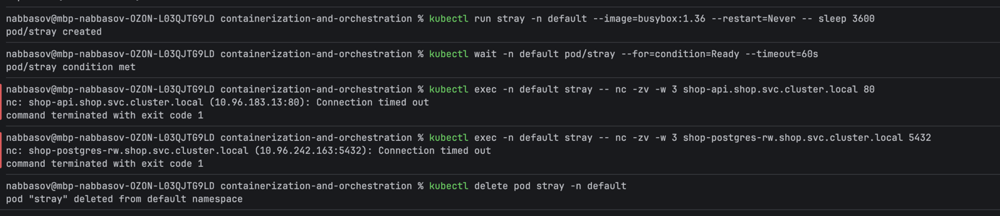

Отдельно отмечу: имена из stray резолвятся (в default нет политик, DNS ему никто не
резал), IP сервиса он узнаёт — а соединение дропается. И это при `ipBlock: 0.0.0.0/0`
в политике api: под пришёл со своей identity, а не как world, и CIDR-правило его не
коснулось — ровно как и предсказывали в Part 4.

Из пода api одним заходом: к постгресу — open, к worker и наружу — тишина,
DNS при этом отвечает:

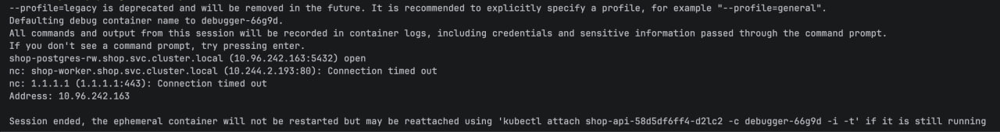

От worker к api — тоже timeout (debug-контейнером в worker, тем же способом).

Скрейп Prometheus под политиками (запрос к его API из кластера):

```
shop-api-...-d2lc2    http://10.244.2.32:8080/metrics   health=up lastError=none
shop-api-...-mw7jf    http://10.244.1.115:8080/metrics  health=up lastError=none
shop-api-...-spv4b    http://10.244.2.225:8080/metrics  health=up lastError=none
shop-worker-...-bhjmj http://10.244.2.193:8080/metrics  health=up lastError=none
shop-worker-...-bvbn6 http://10.244.1.207:8080/metrics  health=up lastError=none
```

И сквозная проверка конвейера: POST /order изнутри пода api создал заказ
(`{"id":15895,"item":"netpol-test","processed":false}`), через пару секунд worker
отчитался `processed 1 orders` — значит api → БД и worker → БД живы не только на
уровне TCP, но и по делу.

## Part 6 — Скрытая поломка

Поломку вносил скрипт `chaos/break-net.sh`: в нём четыре варианта (кривой лейбл в
allow-правиле, не тот порт, выпиленный DNS-egress и т.п.), конкретика закодирована
в base64, чтобы не спойлерить самому себе, выбор случайный. Скрипт молча патчит
одну из живых NetworkPolicy и ничего не говорит. Перед этим поднял Hubble UI
(`cilium hubble enable --ui`, потом `cilium hubble ui`) и пустил фоновый цикл
заказов, чтобы на карте были живые потоки.

Симптом появился сразу: POST /order перестал отвечать (curl по таймауту отдаёт 000).
Первым делом проверил /health — он отвечает `ok`. Значит, api жив и вход снаружи
цел, ломается что-то дальше по пути заказа.

Открыл карту в Hubble UI — и там всё видно: красный пунктир в postgres на 5432,
в таблице флоу куча dropped на тот же порт. При этом world → api и prometheus → api
зелёные, и часть потоков к 5432 всё-таки forwarded.

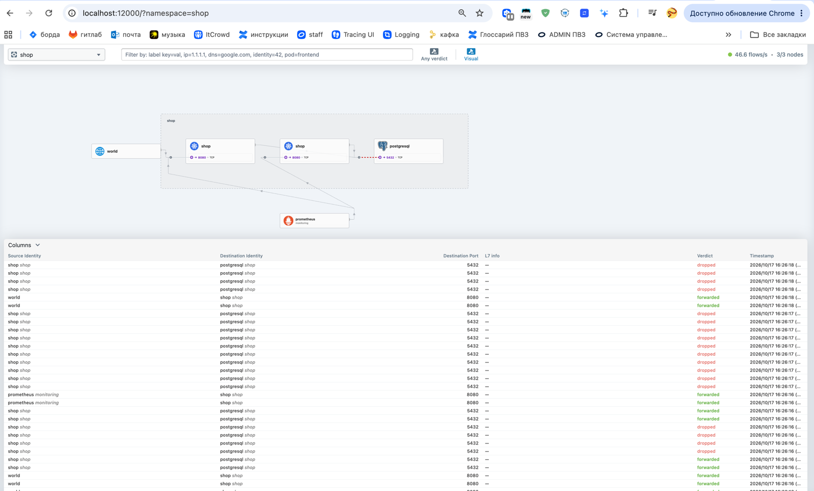

Карта говорит «что», но не говорит «кто именно» и «на какой стороне дроп». Пошёл в
hubble observe. Нюанс: агент Hubble видит только флоу своей ноды, поэтому exec в
случайный под даёт пустоту — опросил все три (UI такой проблемы не имеет, он ходит
через relay):

```
shop/shop-api-58d5df6ff4-spv4b:57662 <> shop/shop-postgres-1:5432 policy-verdict:none INGRESS DENIED (TCP Flags: SYN)
shop/shop-api-58d5df6ff4-mw7jf:42158 <> shop/shop-postgres-1:5432 policy-verdict:none INGRESS DENIED (TCP Flags: SYN)
shop/shop-api-58d5df6ff4-d2lc2:41496 <> shop/shop-postgres-1:5432 policy-verdict:none INGRESS DENIED (TCP Flags: SYN)
```

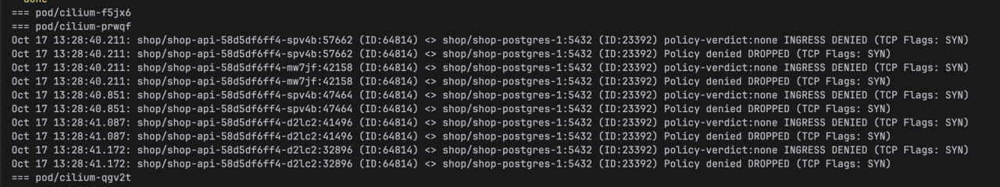

Тут уже всё: дропаются все три пода api (worker в дропах не светится — вот чьи
forwarded были на карте), SYN умирает на входе в postgres, вердикт INGRESS DENIED,
причём `policy-verdict:none` — ни одно ingress-правило не сматчило, сработал
default deny. Значит, виновата ingress-часть политики shop-postgres, а не egress
у api — иначе было бы EGRESS DENIED на ноде отправителя.

Открыл живую политику и сравнил с тем, что рендерит чарт:

```yaml
  ingress:
  - from:
    - podSelector:
        matchLabels:
          app.kubernetes.io/component: apiserver   # в чарте — api
          app.kubernetes.io/instance: shop
```

Один лейбл: `apiserver` вместо `api`. Поды api подписаны `component=api`, селектор
их больше не матчит — и весь api-трафик падает в default deny. Соседнее правило для
worker нетронуто, поэтому worker до базы доходил.

С фиксом интересный момент: поломка внесена в живой объект мимо чарта, в чарте всё
правильно. Но просто `helm upgrade` дрифт не лечит — он сравнивает старый манифест
с новым, они одинаковые, патч пустой, кривой лейбл остаётся. Поэтому заново утвердил
желаемое состояние из релиза:

```
helm get manifest shop -n shop | kubectl apply -n shop -f -
```

(Первый раз запустил без `-n shop` и kubectl молча развернул копию всего магазина
в default — манифесты из `helm get manifest` не несут namespace, его подставляет
клиент. Вычистил и запомнил.)

Проверка: POST /order снова отдаёт заказ (`{"id":15915,"item":"fixed"}`), в hubble
вместо DENIED — `shop-api-... -> shop-postgres-1:5432 to-endpoint FORWARDED`,
worker обрабатывает. Матрица снова зелёная.

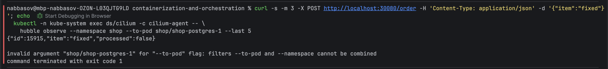

Карта в Hubble UI после фикса — красный пунктир к postgres исчез, потоки на 5432
снова forwarded (заодно на карте появился cloudnative-pg, который ходит в поды БД):

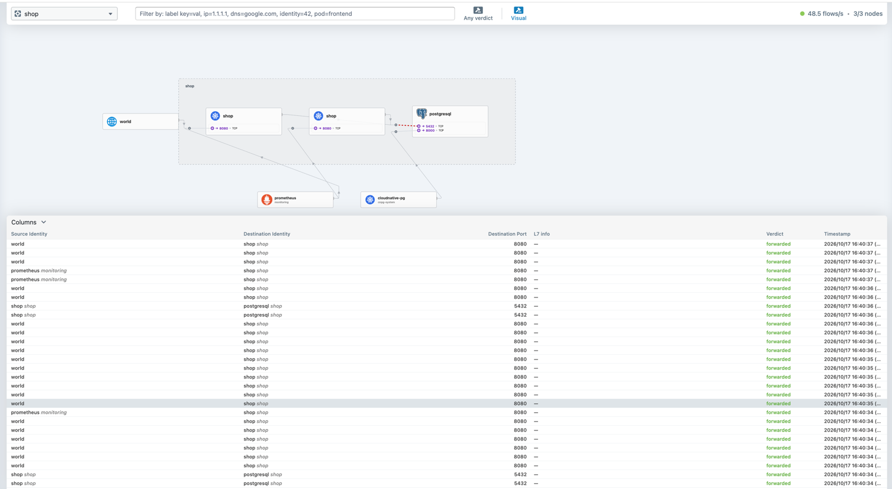

## Part 7 — Мониторинг

Стек из лабы 2 (kube-prometheus-stack в monitoring) уже стоит, новый не поднимал.
Повезло с конфигурацией: Prometheus развёрнут с пустым `serviceMonitorSelector: {}`,
то есть подбирает все ServiceMonitor'ы во всех namespace — никакие специальные
лейблы на мои объекты вешать не пришлось.

Метрики сети живут не в приложении, а в CNI: дропы по политикам и вердикты видит
только Cilium. Hubble и так считает каждый флоу (этим я чинил Part 6), осталось
включить экспорт в Prometheus. Cilium у меня — это helm-релиз (CLI ставит через
Helm), так что поверх существующих значений:

```
helm upgrade cilium cilium/cilium -n kube-system --reuse-values \
  --set hubble.metrics.enabled="{drop,dns,tcp,flow}" \
  --set hubble.metrics.serviceMonitor.enabled=true
```

После rollout'а даемонсета в kube-system появился ServiceMonitor hubble, Prometheus
подхватил его сам, и в нём появились `hubble_drop_total`, `hubble_tcp_flags_total`,
`hubble_flows_processed_total`:

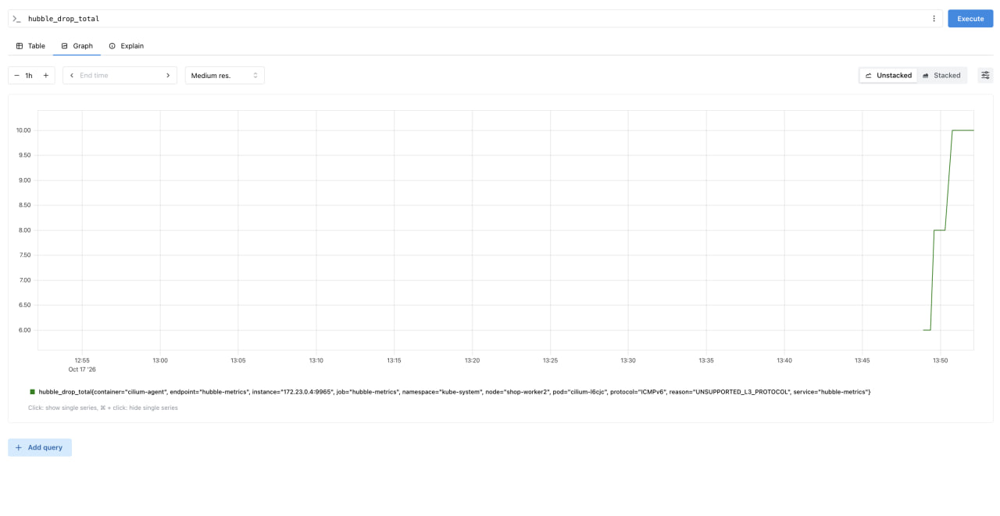

А вот `hubble_dns_*` оказались пустыми, хотя метрика dns включена. Разобрался:
DNS-трафик становится виден Hubble как DNS (а не как безликие UDP-пакеты) только
когда он идёт через L7 DNS-прокси Cilium, а туда он попадает только если на под
действует CiliumNetworkPolicy с dns-правилами. Мои vanilla NetworkPolicy пускают
DNS на L3/L4 — мимо прокси, метрике нечего считать. Городить CNP ради одной метрики
не стал: здоровье DNS взял из метрик самого CoreDNS, их стек скрейпит из коробки.

Алерты добавил в PrometheusRule чарта отдельной группой shop.network (пороги —
в values, `monitoring.network.*`). Логика тройки:

1. **ShopPolicyDeniedTraffic** — устойчивый поток дропов `POLICY_DENIED`
   (> 0.1 пакета/с за 5 минут). В сети с default deny такой поток — это либо
   сломанное allow-правило после релиза (ровно мой Part 6: приложение молчит,
   в логах пусто, виден он только на уровне CNI), либо посторонний клиент
   стучится туда, куда не положено. В обоих случаях надо смотреть.
2. **ShopTCPResetStorm** — доля RST к новым SYN выше 0.5. Это вторая половина
   диагностической пары: дроп политики — это тишина и таймауты, а RST значит,
   что сеть цела и пакеты доходят, но получатель активно отказывает — умерший
   бекенд, закрытый порт, перегруз. Разные причины — разные дежурные действия.
3. **ShopDNSResolutionErrors** — SERVFAIL/REFUSED от CoreDNS: кластерный резолв
   деградировал, сервисы перестанут находить друг друга. NXDOMAIN в алерт
   намеренно не входит: из-за ndots=5 и search-доменов каждый резолв внешнего
   имени порождает пачку NXDOMAIN — это штатный шум (на дашборде его хорошо
   видно). А «DNS молча съела политика» — это снова POLICY_DENIED, его ловит
   первый алерт.

Триггерил первый: запустил постороннего клиента в default (там политик нет),
который долбится в api раз в 0.2 секунды. SYN умирают на ingress api, счётчик
POLICY_DENIED растёт (~1.2 пакета/с), через 3 минуты (for: 3m) алерт перешёл
в FIRING; два других при этом спокойно зелёные:

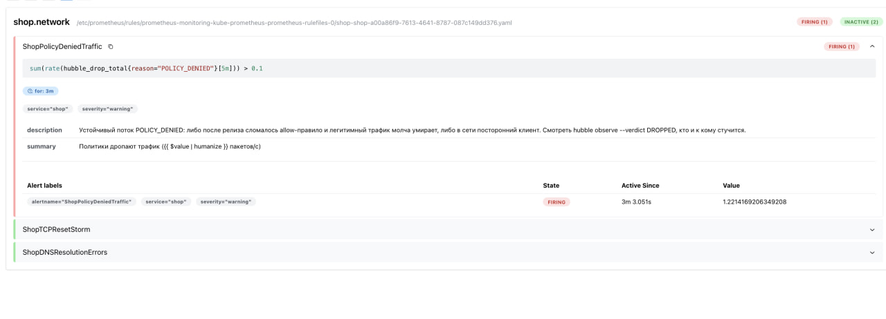

Дашборд тоже зашит в чарт: ConfigMap с лейблом `grafana_dashboard: "1"` — сайдкар
Grafana в стеке смотрит все namespace и провиженит такие конфигмапы сам. Четыре
панели: дропы по причинам, SYN/RST, DNS-ответы по rcode, флоу по вердиктам.

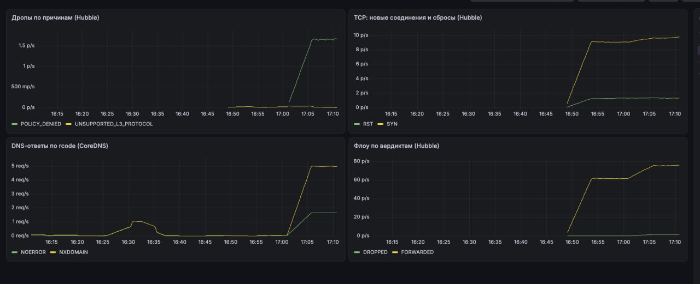

На скрине как раз момент «атаки» stray-пода: полка POLICY_DENIED на панели дропов
(по ней и горел алерт), рост SYN и заодно всплеск NXDOMAIN — busybox перебирает
search-домены при каждом резолве. Графики начинаются с 16:50 — метрики существуют
с момента включения.

## Итог

- клиент не заметил ни одного из 35 убитых подов: 5401/5401 запросов успешны
  (Part 2);
- NetworkPolicy — шаблоны чарта: default deny плюс точечные allow, включая DNS
  egress (Part 4), матрица доступа полностью зелёная (Part 5);
- скрытая поломка найдена по карте потоков и вердиктам Hubble, а не перебором,
  и починена переутверждением состояния из релиза (Part 6);
- мониторинг сети поверх стека лабы 2: метрики Hubble + CoreDNS, три алерта
  с обоснованием (один оттриггерен до FIRING), дашборд — всё зашито в чарт
  (Part 7).
